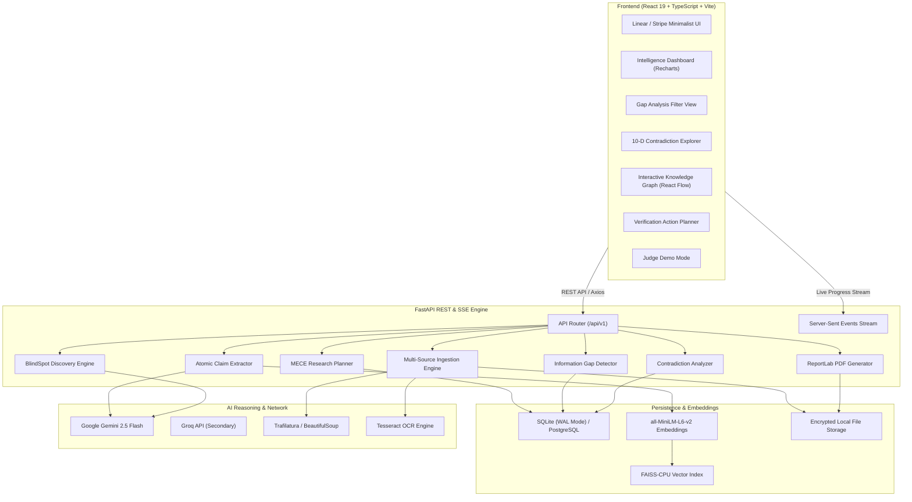

# PROOFPATH AI
> *"Know what's missing before you decide."*

[](https://fastapi.tiangolo.com)
[](https://react.dev)
[](https://www.typescriptlang.org)
[](https://www.python.org)
[](https://tailwindcss.com)
[](https://pytest.org)
[](LICENSE)

**PROOFPATH AI** is a professional forensic information intelligence platform engineered to investigate complex multi-source documents and discover **missing information**, **incomplete requirements**, **cross-source factual contradictions**, **outdated information**, **unverified claims**, and **the critical questions you forgot to ask**.

Built specifically for high-stakes decision-makers—grant applicants, compliance officers, academic researchers, legal analysts, and procurement teams.

---

## 📌 Table of Contents
- [Problem Statement](#-problem-statement)
- [The Solution](#-the-solution)
- [Key Features](#-key-features)
- [System Architecture](#-system-architecture)
- [Decision-Readiness Index (DRI)](#-decision-readiness-index-dri)
- [Technology Stack](#-technology-stack)
- [Project Structure](#-project-structure)
- [Installation & Quickstart](#-installation--quickstart)
- [Environment Configuration](#-environment-configuration)
- [API Documentation](#-api-documentation)
- [Dedicated Judge Demo Mode](#-dedicated-judge-demo-mode)
- [Production Deployment](#-production-deployment)
- [Security & Software Reliability](#-security--software-reliability)
- [Limitations](#-limitations)
- [Future Scope](#-future-scope)

---

## 🚨 Problem Statement

Every critical decision—from applying for a multimillion-dollar federal fellowship, submitting a government tender, or entering an enterprise vendor contract—requires reconciling information across multiple disparate documents: application guidelines, institutional memorandums, amendment circulars, and FAQs.

Traditional LLMs and AI summarizers fail disastrously in this domain:
1. **The Affirmation Trap**: Summarizers summarize only what is present in the text. They are silent about what is **missing**, giving decision-makers dangerous false confidence.
2. **Hallucination & Smoothing**: When two documents disagree (e.g., an older memo states a \$25,000 stipend while a new circular states \$35,000), conversational LLMs blend the facts or arbitrarily pick one without flagging the discrepancy.
3. **The "Unknown Unknowns" (BlindSpots)**: Users only ask questions about topics they already anticipate. They forget to ask whether international medical insurance is mandatory, whether scholarships are taxable, or if changing academic supervisors cancels funding.
4. **Lack of Evidence Traceability**: Generic AI gives ungrounded answers. In high-stakes settings, an analyst needs the exact verbatim quote, page number, and source document.

---

## 💡 The Solution

**PROOFPATH AI** does not act as a chatbot or passive summarizer. Instead, it treats sources as **competing witness testimonies** and conducts an automated forensic cross-examination:

```
┌────────────────────────────────────────────────────────────────────────┐
│                          PROOFPATH AI PIPELINE                         │
└────────────────────────────────────────────────────────────────────────┘
  [PDFs / URLs / Memos] ──▶ Ingestion & OCR ──▶ Anti-SSRF Validation
           │
           ▼
  [Research Planner] ──▶ Decomposes Goal into MECE Atomic Requirements
           │
           ▼
  [Claim Extractor] ──▶ Extracts Atomic Claims with Char-Offset Quotes
           │
           ▼
  [Vector Engine] ──▶ FAISS + SentenceTransformers Semantic Retrieval
           │
           ▼
  [Forensic Intelligence]
    ├── Gap Detection (Covered, Missing, Incomplete, Conflict, Outdated, Unverified)
    ├── Contradiction Matrix (10-Dimensional Scope Cross-Examination)
    ├── Temporal Freshness (Decay, Superseded Circulars, Effective Dates)
    └── BlindSpot Discovery (Counterfactual Reasoning for Overlooked Questions)
           │
           ▼
  [Decision-Readiness Index (DRI)] ──▶ Deterministic Weighted Mathematical Score
           │
           ▼
  [Outputs] ──▶ Interactive Graph + Actionable Checklist + ReportLab PDF Dossier
```

---

## ✨ Key Features

### 1. Multi-Source Ingestion Engine
- **PDF Documents**: Direct vector text extraction with page numbers via PyMuPDF.
- **Scanned Document OCR**: Automatic image-page detection and digitizing using Tesseract OCR.
- **Web Article Extraction**: Main article scraping, boilerplate removal, domain extraction, and publication date detection via Trafilatura and BeautifulSoup.
- **Plain Text / Memorandums**: Verbatim administrative text ingestion with SHA-256 cryptographic content hashing.
- **Enterprise Anti-SSRF Protection**: Strict host resolution rejecting loopback (`127.0.0.1`, `localhost`), cloud metadata (`169.254.169.254`), private RFC-1918 subnets, and non-HTTP protocols.

### 2. Atomic Claim Extraction & Grounding
- Uses Gemini 2.5 Flash to extract atomic, independently verifiable factual statements.
- **Zero Hallucination Quoting**: Every extracted claim is tied to its exact verbatim quote, character offset range (`start_char`, `end_char`), page number, and extraction confidence.
- Hybrid semantic retrieval via `SentenceTransformers` (`all-MiniLM-L6-v2`) and FAISS vector indexing.

### 3. Information Gap Detection Engine (6 Forensic Statuses)
Evaluates whether collected evidence completely satisfies every decision requirement:
1. `COVERED`: Rigorous, substantiated evidence directly satisfies the requirement.
2. `MISSING`: Zero relevant evidence exists across any reviewed source.
3. `INCOMPLETE`: Partial evidence exists, but crucial operational parameters are missing.
4. `POTENTIAL CONFLICT`: Competing claims provide incompatible criteria or values.
5. `POTENTIALLY OUTDATED`: Information originates from superseded or expired documents.
6. `UNVERIFIED`: Assertions exist without verifiable empirical backing or primary citation.

### 4. 10-Dimensional Contradiction Intelligence
Cross-examines conflicting statements along 10 distinct contextual axes to distinguish genuine conflicts from legitimate scope differences:
- **Subject** & **Category**
- **Geographic Scope** (National vs State vs International)
- **Applicant Category** (Undergraduate vs Postgraduate vs PhD)
- **Academic Year** & **Application Cycle**
- **Numerical Values** & **Measurement Units**
- **Effective Dates** & **Applicable Conditions**

### 5. Temporal Freshness & Decay Analysis
- Automatically parses publication dates, effective dates, expiry dates, and amendment histories.
- Identifies superseded guidelines (e.g., a 2022 policy replaced by a 2026 circular).
- Assigns freshness badges: `Operative`, `Superseded`, or `Expired`.

### 6. BlindSpot Discovery Engine
- Uses counterfactual risk reasoning to identify high-impact questions the user forgot to ask.
- Automatically queries the current FAISS vector space to determine whether each BlindSpot is already covered or completely unaddressed.
- **One-Click Promotion**: Promotes any BlindSpot into an active requirement in the research plan.

### 7. Actionable Verification Planner
- Converts findings into prioritized verification tasks (`CRITICAL`, `HIGH`, `MEDIUM`, `LOW`).
- Allows users to toggle task completion, add custom verification steps, and attach notes.

### 8. Downloadable Institutional PDF Dossier
- Generates professional, multi-page downloadable PDF reports using Python and **ReportLab**.
- Includes cover page, executive briefing, DRI score card, source bibliography, requirement coverage matrix, contradiction breakdown, and verification checklist.

---

## 🧮 Decision-Readiness Index (DRI)

PROOFPATH AI computes an explainable, deterministic mathematical readiness score ($0 - 100\%$) based on 4 weighted pillars:

$$\text{DRI} = 0.35 \times \text{Coverage} + 0.30 \times \text{Consistency} + 0.15 \times \text{Freshness} + 0.20 \times \text{Verification}$$

Where:
- **Coverage ($35\%$)**: Percentage of requirements with `COVERED` or `PARTIAL` evidence.
- **Consistency ($30\%$)**: Penalized by the number and severity of unresolved factual contradictions:
  $$\text{Consistency} = \max(0, 100 - 25 \times N_{\text{conflicts}})$$
- **Freshness ($15\%$)**: Ratio of operative vs superseded/outdated sources.
- **Verification ($20\%$)**: Ratio of completed verification tasks in the action checklist.

---

## 🏛️ System Architecture



---

## 💻 Technology Stack

| Layer | Technologies |
| :--- | :--- |
| **Frontend Framework** | React 19, TypeScript 5.6, Vite 5.4 |
| **Styling & Design System** | Tailwind CSS 3.4, Radix UI, Lucide React, Framer Motion |
| **State & Data Fetching** | TanStack Query v5, Zustand, Axios |
| **Visualizations** | Recharts 2.13, @xyflow/react (React Flow) |
| **Backend Framework** | Python 3.12+, FastAPI 0.115, Uvicorn (ASGI) |
| **Data Validation & ORM** | Pydantic v2, Pydantic-Settings, SQLAlchemy 2.0 |
| **Database** | SQLite (with WAL mode enabled) / PostgreSQL-ready |
| **Vector Search & ML** | FAISS-CPU, SentenceTransformers (`all-MiniLM-L6-v2`) |
| **Document Processing** | PyMuPDF (fitz), Trafilatura, BeautifulSoup4, Pytesseract |
| **PDF Generation** | ReportLab 5.1 |
| **Primary AI Provider** | Google Gemini 2.5 Flash / Flash Lite (via `google-genai`) |
| **Fallback AI Provider** | Groq (`llama-3.3-70b-versatile`) + Local Deterministic Heuristics |
| **Testing & Reliability** | Pytest, Chrome DevTools Protocol (CDP) Headless Automation |

---

## 📂 Project Structure

```text
PROOFPATH-AI/
├── .env.example                     # Root environment variable template
├── .gitignore                       # Production gitignore (excludes db, env, uploads)
├── README.md                        # Master project documentation
├── render.yaml                      # 1-Click Render deployment blueprint
│
├── backend/                         # FastAPI Application Backend
│   ├── app/
│   │   ├── agents/                  # Forensic AI agents (Planner, Extractor, GapDetector, etc.)
│   │   ├── api/v1/endpoints/        # 69 REST endpoints (research, sources, findings, demo, etc.)
│   │   ├── core/                    # Middleware, security validation, exception handlers
│   │   ├── database/                # SQLAlchemy session, engine, migrations
│   │   ├── ingestion/               # Web scraper, PDF processor, OCR, metadata extractor
│   │   ├── intelligence/            # Contradiction analyzer, temporal decay, gap engine
│   │   ├── models/                  # Database models (ResearchSession, Source, Claim, etc.)
│   │   ├── reports/                 # ReportLab PDF generator and Markdown exporter
│   │   ├── schemas/                 # Pydantic request/response validation schemas
│   │   ├── services/                # Orchestration services & background job manager
│   │   └── utils/                   # Mock demo dataset, text chunker, anti-SSRF utils
│   ├── tests/                       # Automated test suite (83 tests)
│   │   ├── test_qa_security.py      # Anti-SSRF, upload limits, error sanitization
│   │   ├── test_qa_backend_endpoints.py # CRUD, cascades, reports, demo lifecycle
│   │   └── test_qa_real_workflow.py # End-to-end multi-source live pipeline test
│   ├── Dockerfile                   # Production Python 3.12 Docker container
│   ├── Procfile                     # Heroku / Railway web process config
│   ├── requirements.txt             # Python dependencies
│   └── pytest.ini                   # Pytest configuration
│
├── frontend/                        # React + TypeScript Frontend
│   ├── src/
│   │   ├── components/              # UI components (demo banner, contradiction card, etc.)
│   │   ├── pages/                   # Application pages (Dashboard, Research, Gaps, Report, etc.)
│   │   ├── routes/                  # React Router v7 configuration
│   │   ├── services/                # Axios API services and error mappings
│   │   ├── store/                   # Zustand global state
│   │   ├── types/                   # TypeScript interfaces
│   │   └── utils/                   # Formatting utilities and sample data
│   ├── public/                      # Static assets & Netlify _redirects
│   ├── vercel.json                  # Vercel SPA client-side routing rewrites
│   ├── package.json                 # Node dependencies
│   ├── tailwind.config.js           # Tailwind design tokens
│   └── vite.config.ts               # Vite configuration with proxy
│
├── scripts/                         # Automation & Headless Chrome Testing
│   └── qa_frontend_interactive_audit.js # CDP-driven 16-step UI test
└── docs/                            # Deep-dive architecture and API specs
    ├── architecture.md
    └── api-documentation.md
```

---

## 🚀 Installation & Quickstart

### Prerequisites
- **Python**: Version 3.12 or higher
- **Node.js**: Version 20.x or higher with `npm`
- **Tesseract OCR** (Optional): For scanned PDF image digitization.
  - Windows: `winget install UB-Mannheim.TesseractOCR`
  - Linux: `sudo apt install tesseract-ocr`
  - macOS: `brew install tesseract`

---

### Step 1: Clone Repository
```bash
git clone https://github.com/uk0976/PROOFPATH-AI.git
cd PROOFPATH-AI
```

---

### Step 2: Backend Setup
```bash
cd backend

# Create and activate virtual environment
python -m venv venv

# On Windows:
venv\Scripts\activate
# On Linux/macOS:
source venv/bin/activate

# Install dependencies
pip install --upgrade pip
pip install -r requirements.txt

# Configure environment
cp .env.example .env
# Edit .env and insert your GEMINI_API_KEY (optional: fallback heuristics run without key)

# Start FastAPI development server
uvicorn app.main:app --reload --host 127.0.0.1 --port 8000
```
Backend will be live at: `http://localhost:8000` (Interactive Swagger docs: `http://localhost:8000/docs`).

---

### Step 3: Frontend Setup
In a new terminal:
```bash
cd frontend

# Install Node dependencies
npm install

# Configure environment
cp .env.example .env

# Start Vite development server
npm run dev
```
Frontend will be live at: `http://localhost:5173`.

---

## ⚙️ Environment Configuration

### Backend (`backend/.env`):
| Variable | Default Value | Description |
| :--- | :--- | :--- |
| `GEMINI_API_KEY` | `""` | Google Gemini API key for claim extraction and BlindSpots. |
| `GROQ_API_KEY` | `""` | Optional secondary provider for ultra-fast fallback. |
| `PRIMARY_MODEL` | `gemini-2.5-flash` | Primary multimodal model. |
| `APP_ENV` | `development` | Set to `production` in live deployments. |
| `PORT` | `8000` | Application server port. |
| `CORS_ORIGINS` | `["http://localhost:5173"]`| Allowed origins (JSON array or comma-separated). |
| `DATABASE_URL` | `sqlite:///./proofpath.db` | Database connection string (SQLite WAL or PostgreSQL).|
| `UPLOAD_DIR` | `./uploads` | Directory for ingested PDFs and documents. |
| `REPORT_DIR` | `./reports` | Directory for compiled PDF dossiers. |

### Frontend (`frontend/.env`):
| Variable | Default Value | Description |
| :--- | :--- | :--- |
| `VITE_API_BASE_URL` | `http://localhost:8000/api/v1` | Base URL of the FastAPI backend. |

---

## 📖 API Documentation

Interactive Swagger documentation is auto-generated and accessible at:
- **Swagger UI**: `http://localhost:8000/docs`
- **ReDoc**: `http://localhost:8000/redoc`
- **OpenAPI Schema**: `http://localhost:8000/openapi.json`

### Core Endpoints Overview:
| HTTP Method | Route | Description |
| :--- | :--- | :--- |
| `GET` | `/health` | Service health check and uptime probe |
| `POST` | `/api/v1/research/` | Create a new research session |
| `GET` | `/api/v1/research/{id}` | Retrieve session details & Decision-Readiness Index |
| `POST` | `/api/v1/sources/{id}/pdf` | Ingest PDF document with PyMuPDF & OCR |
| `POST` | `/api/v1/sources/{id}/url` | Ingest web URL with anti-SSRF validation |
| `POST` | `/api/v1/sources/{id}/text` | Ingest verbatim memorandum / plain text |
| `POST` | `/api/v1/research/{id}/start`| Trigger the automated forensic intelligence pipeline |
| `GET` | `/api/v1/research/{id}/events`| Live Server-Sent Events (SSE) progress stream |
| `GET` | `/api/v1/findings/{id}/gaps` | List detected gaps across the 6 finding categories |
| `GET` | `/api/v1/findings/{id}/conflicts` | List 10-dimensional contradictory claims |
| `GET` | `/api/v1/research/{id}/blindspots` | Retrieve AI-discovered unasked questions |
| `POST` | `/api/v1/research/{id}/blindspots/{bid}/add-to-plan` | Promote BlindSpot to active requirement |
| `GET` | `/api/v1/reports/{id}/pdf` | Download ReportLab multi-page investigation dossier |
| `GET` | `/api/v1/demo/session` | Initialize or load the pre-seeded judge demonstration |

---

## 🎯 Dedicated Judge Demo Mode

For hackathon judges and evaluators who wish to explore PROOFPATH AI **immediately** without waiting for live file uploads or needing API keys:

1. Launch both backend and frontend.
2. In the browser, navigate to: `http://localhost:5173/demo` (or click **"Explore Demo Investigation"** on the landing page).
3. The platform instantly initializes a pre-seeded, realistic investigation:
   - **Case Study**: *Federal STEM Postgraduate Research Scholarship (FSPRS)*
   - **Sources**: 3 official documents (2026 Guidelines PDF, Dean's Office Memo, 2022 Superseded Rules).
   - **Claims**: 10 grounded atomic claims with character offsets.
   - **Gaps & Conflicts**:
     - 🚨 **Missing Information**: Mandatory international health & repatriation insurance is unmentioned in any source.
     - ⚠️ **Potential Contradiction**: 2026 Guidelines cite \$35,000/yr vs 2022 Circular citing \$25,000/yr.
     - ⏳ **Outdated Source**: 2022 rules flagged as superseded.
   - **BlindSpots**: 3 high-impact questions discovered (Taxability of stipend, part-time work limits, travel grant rollover).
   - **Action Checklist**: Prioritized verification tasks with interactive toggling.
   - **PDF Report**: One-click download of the complete ReportLab dossier.

---

## 🚢 Production Deployment

### Frontend (Vercel / Netlify)
The frontend is pre-configured for static single-page app (SPA) hosting:
- `frontend/vercel.json` contains route rewrites for client-side routing.
- `frontend/public/_redirects` ensures Netlify and Cloudflare Pages route all subpaths to `index.html`.

**Deploy to Vercel**:
```bash
cd frontend
npm run build
# Deploy via Vercel CLI or connect your GitHub repository in the Vercel dashboard:
# - Root Directory: frontend
# - Build Command: npm run build
# - Output Directory: dist
# - Environment Variable: VITE_API_BASE_URL=https://your-backend-api.onrender.com/api/v1
```

### Backend (Render / Railway / Docker)
The backend includes a production Dockerfile and Render blueprint:
- `backend/Dockerfile` installs system Tesseract OCR, Python 3.12, and uvicorn.
- `render.yaml` defines a 1-click Render web service with persistent storage disk.

**Deploy with Docker**:
```bash
cd backend
docker build -t proofpath-backend .
docker run -p 8000:8000 -e GEMINI_API_KEY="your_key" proofpath-backend
```

---

## 🛡️ Security & Software Reliability

PROOFPATH AI underwent a rigorous, senior QA engineering audit:
- **83 Backend Tests Passing (`pytest`)**: Verified security, cascade deletions, anti-SSRF, and the complete multi-source pipeline.
- **16 Frontend Interactive Tests Passing**: Headless Chrome DevTools Protocol (CDP) verified route mounting, form population, tab switching, filters, checklist updates, and responsive drawer navigation with **0 console errors**.
- **Anti-SSRF Protection**: Prevents attacks against loopback, cloud metadata endpoints, and internal subnets.
- **Payload Limits**: Rejects non-PDF extensions with HTTP 415 and caps uploads at 50 MB.
- **Zero Secrets Committed**: All keys, `.env`, and database artifacts are strictly gitignored.

---

## ⚠️ Limitations

1. **Tesseract OCR Binary Dependency**: OCR for scanned image-only PDFs requires the `tesseract` binary installed on the host OS. Without it, scanned image-only PDFs gracefully return an informative empty text warning.
2. **In-Memory Vector Search**: FAISS operates in-memory (`FAISS-CPU`). On server restart, vector indexes are regenerated from persisted SQLite chunk records.
3. **AI Fallback Determinism**: When `GEMINI_API_KEY` is omitted, the system falls back to rule-based heuristics. Nuanced cross-source reasoning is best experienced with an active Gemini API key.
4. **SQLite Concurrency**: By default, SQLite is used with Write-Ahead Logging (`WAL`). For enterprise multi-tenant deployments, configure `DATABASE_URL` to point to a PostgreSQL instance.

---

## 🔮 Future Scope

- **Cloud Vector Database**: Integration with Qdrant, Pinecone, or `pgvector` for distributed enterprise scaling.
- **Multi-Tenant Collaboration**: Real-time multi-analyst investigation workspaces with role-based access control (RBAC).
- **Chrome Extension**: One-click evidence clipping from regulatory portals, government gazettes, and academic databases.
- **Direct Regulatory Connectors**: Pre-built integrations with Grants.gov, Federal Register, EUR-Lex, and SEC EDGAR.
- **Live Cross-Examination Debates**: Autonomous agent debates between opposing claims to evaluate evidentiary strength.

---

## 👥 Hackathon Submission Details

- **Event**: Shinchan Online Hackathon
- **Team**: Devengers 3.O
- **Project**: PROOFPATH AI
- **Repository**: [https://github.com/uk0976/PROOFPATH-AI](https://github.com/uk0976/PROOFPATH-AI)
- **Status**: Complete, Tested, and Production-Ready.
